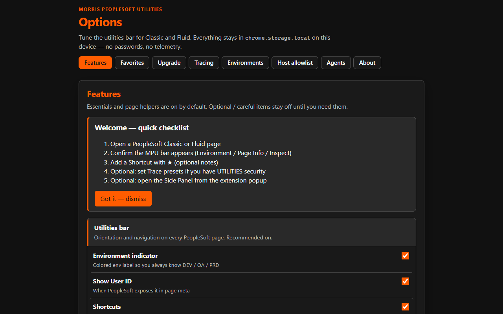
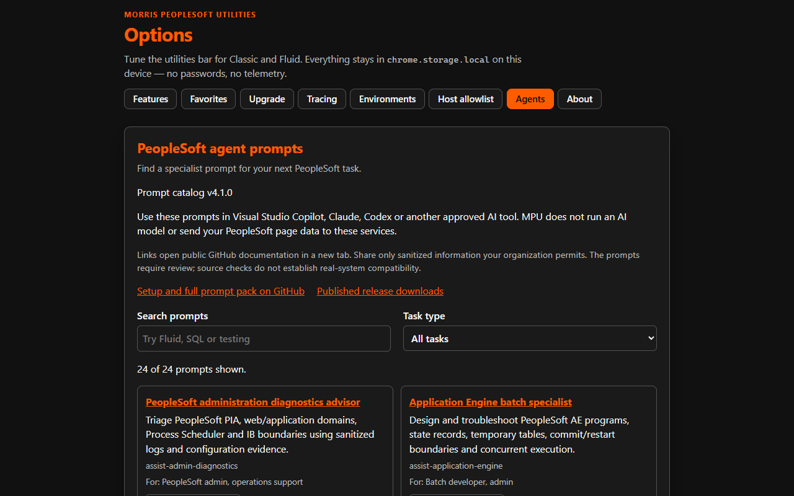
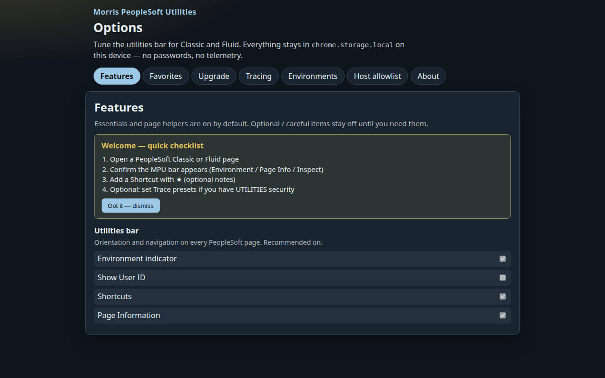

# Morris PeopleSoft Utilities

[](https://github.com/hackmods/Morris-Peoplesoft-Utilities/actions/workflows/ci.yml)
[](LICENSE)
[](https://github.com/hackmods/Morris-Peoplesoft-Utilities/blob/main/store/SUBMISSION_CHECKLIST.md)

**Morris PeopleSoft Utilities (MPU)** is a modern Manifest V3 Chrome extension that helps college business analysts and technical staff work faster in PeopleSoft **Classic** and **Fluid**—with privacy-first defaults and AODA-oriented accessibility.

Maintained by **[hackmods](https://github.com/hackmods)** (Ryan Morris).

## Why MPU?

Classic PS Utilities improved PeopleSoft usability but aged out of Chrome Web Store and Fluid expectations. MPU is a greenfield TypeScript rewrite aimed at an **official Chrome Web Store** listing: equal feature access for BA and technical users, no credential storage, no telemetry, and documented compliance controls (including an opt-in host allowlist).

## Features

| Business analysts | Technical staff |
|---|---|
| Environment labels | PeopleCode / SQL trace toggle |
| Favorites with CSV import/export | Field Inspector (Classic, Fluid, Classic-in-Fluid) |
| Page information + upgrade watch | New window / deep links / Admin jumps |
| Field Entry (bulk paste / multi-row grids) | Trace profiles + PCode stubs |
| Advanced Search & Correct History helpers | Settings JSON backup |
| Quiet mode for env prompts | |

**Compatibility target:** PeopleTools **8.62**, including Classic/Classic Plus, Fluid, and Classic components hosted inside Fluid. Real-environment sign-off remains required; see [the 8.62 validation checklist](docs/testing/peopletools-8.62.md). Chrome 116 or newer is required.

## Install

### Chrome Web Store (recommended)

Store listing is in progress. When you are ready to submit:

- [`store/PUBLISH.md`](store/PUBLISH.md) — **start here** (publish checklist)
- [`store/DEVELOPER_DASHBOARD.md`](store/DEVELOPER_DASHBOARD.md) — step-by-step upload guide
- [`docs/release-readiness.md`](docs/release-readiness.md) — blocking vs nice-to-have
- [`store/SUBMISSION_CHECKLIST.md`](store/SUBMISSION_CHECKLIST.md) — dashboard checklist

When published, this section will link the Store URL.

### Load unpacked (developers)

```bash
npm ci
npm run generate:icons
npm run build
```

1. Open `chrome://extensions`
2. Enable **Developer mode**
3. **Load unpacked** → select the `dist/` folder

Or download the latest zip from [GitHub Releases](https://github.com/hackmods/Morris-Peoplesoft-Utilities/releases).

## Privacy

- Settings stay in `chrome.storage.local` on your device
- **No passwords**, **no analytics**, **no developer phone-home**
- Full policy: [`docs/privacy.md`](docs/privacy.md)

## Accessibility (AODA)

MPU targets **WCAG 2.1 Level AA** for extension UI and the injected utilities bar. Details: [`docs/aoda.md`](docs/aoda.md).

## Screenshots

Listing images (1280×800) live under [`store/assets/screenshots/`](store/assets/screenshots/). Import live PeopleSoft captures with [`store/incoming/`](store/incoming/README.md) and `npm run import:store-screenshots`.

| Utilities bar | Field Inspector | Options |
|:---:|:---:|:---:|
|  |  |  |

Replace mocks with your Classic/Fluid captures before the public Store listing (`npm run audit:store` warns while mocks remain).

## Testing

Automated gates run locally and in CI:

| Command | What it covers |
|---|---|
| `npm test` | Unit, integration, smoke, and a11y Vitest suites |
| `npm run test:coverage` | Same + V8 coverage (thresholds enforced) |
| `npm run test:a11y` | axe WCAG 2A/2AA on popup/options markup |
| `npm run audit` | a11y + Store lint + compliance scan |
| `npm run test:all` | lint + coverage + audits + production build |
| `npm run release:check` | Full release gate (lint, coverage, audits, zip) |

Suites:

- `tests/unit` — URL/adapters, storage, bar, field inspector, trace, search, injects
- `tests/integration` — BA session bootstrap + audit script execution
- `tests/a11y` — axe accessibility
- `tests/smoke` — repo/Store prerequisites and built `dist/` checks

Details: [`docs/testing/automated.md`](docs/testing/automated.md)  
Manual PeopleSoft parity: [`docs/testing/manual-parity-checklist.md`](docs/testing/manual-parity-checklist.md)

## Development

```bash
npm ci
npm run generate:icons
npm run generate:store-assets
npm run lint
npm run test:coverage
npm run audit
npm run build
npm run import:store-screenshots  # live CWS screenshots from store/incoming/
npm run prep:store                # audit + extension zip for dashboard upload
```

See the [wiki sources](wiki/Home.md) and [`CONTRIBUTING.md`](CONTRIBUTING.md).

## PeopleSoft agent prompt pack

Full prompts, skills and templates are distributed separately from the extension. Options → Agents bundles only a searchable public reference catalog; popup/side-panel links open the library and Help links to setup documentation. MPU does not run agents or send page data to AI services.

- **Browse:** [`agents/`](https://github.com/hackmods/Morris-Peoplesoft-Utilities/tree/main/agents) · guide [`agents/README.md`](agents/README.md) · wiki [AI agent prompts](wiki/AI-Agent-Prompts.md)
- **Download:** each GitHub Release attaches `morris-peoplesoft-agents-v*.zip` (or run `npm run package:agents`)

Content v4.2.0 targets PeopleTools 8.62 (confirm application release and PUM image separately): 24 workflows for BA requirements, PeopleCode/SQL, IB/CI, AE/Scheduler, reporting, testing, upgrades, approvals, performance/trace, Fluid/accessibility, Search Framework, portal/branding, conversion, onboarding and specialist training. Complete Copilot, Claude/Codex skill and Cursor exports, three private pillar templates and a private host-evaluation worksheet are included. Options can prepare a blank task brief; it reads no page context.

## Releases

Tagged versions (`v*`) publish the Chrome Web Store zip **and** the agents prompt zip via GitHub Actions. Prefer installing the extension from the Store once live; use Release artifacts for review builds.

Latest: tag **`v1.0.26`** after merge, or run `npm run prep:store` for a local upload zip. Previous: [v1.0.25](https://github.com/hackmods/Morris-Peoplesoft-Utilities/releases/tag/v1.0.25).

## Credits

- **Maintainer / publisher:** [hackmods](https://github.com/hackmods) (Ryan Morris)
- **Inspired by:** PS Utilities — original work by **Uffe Graakjaer**, **Neil Yetman**, and contributors. MPU is a separate greenfield project; legacy sources under `.reference/` are a local behavior oracle and are not shipped in the extension package.

## License

[MIT](LICENSE)
